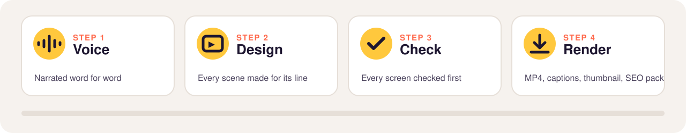
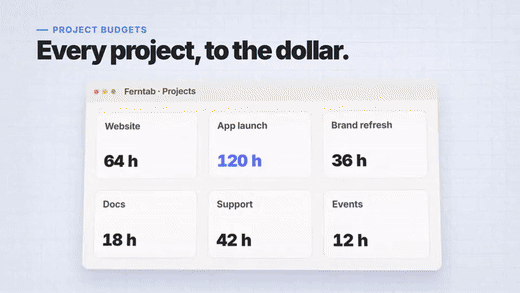

<p align="center"><a href="https://videotempo.com/"></a></p>

<p align="center"><b>VideoTempo is an AI video generator that turns a script, a voiceover or a goal into an animated, narrated video with custom motion graphics, built to rank, hold viewers and sell.</b></p>

<p align="center">
<a href="https://videotempo.com/"></a>&nbsp;
<a href="https://videotempo.com/docs"></a>&nbsp;
<a href="https://videotempo.com/examples"></a>
</p>

## What VideoTempo does

- **Starts from your words.** A script is narrated word for word. A voiceover is transcribed and every scene is timed to it. A goal (a topic or keyword) becomes a researched script you approve first.
- **Makes every scene for its line.** A number becomes a chart, a list an animated list, a screenshot a product scene. No loosely matched stock footage.
- **Delivers what posting needs.** An MP4 in 16:9 or 9:16, captions on screen and as SRT and VTT files, a matching thumbnail and an SEO pack: title, description, tags and chapters.
- **Copies a look.** Paste a link to a video you like and its colours, type, motion and pacing are saved as a style. Only the style, never the content.
- **Scales.** One video or thousands a day, by hand or through an AI agent.

## How a video is made

<p align="center"></p>

Every step is saved as it finishes, so a closed browser never loses a video. A video takes 25 to 120 minutes.

## Made with VideoTempo

<p align="center"><a href="https://videotempo.com/examples"></a></p>

## For developers and AI agents

VideoTempo has a REST API and an MCP server, so Claude Code, Codex, Cursor or your own code can start videos, follow them and download them on autopilot, with a cost cap on every request.

| | |
|---|---|
| REST API | `https://videotempo.com/api/v1` |
| MCP server | `https://videotempo.com/mcp` (Streamable HTTP, JSON-RPC 2.0) |
| Main tools | `get_quote` · `create_video` · `get_video` · `request_changes` · `create_campaign` |
| Safe by design | price first, a cost cap (`maxCredits`) on every video, `requestId` for safe retries |

```bash
claude mcp add --transport http videotempo https://videotempo.com/mcp --header "Authorization: Bearer vt_..."
```

Full reference: **[videotempo.com/docs](https://videotempo.com/docs)**

## Find VideoTempo

[Website](https://videotempo.com/) · [X](https://x.com/videotempohq) · [Instagram](https://www.instagram.com/videotempohq/) · [TikTok](https://www.tiktok.com/@videotempohq) · [Bluesky](https://bsky.app/profile/videotempo.bsky.social) · [Mastodon](https://mastodon.social/@videotempo) · [Crunchbase](https://www.crunchbase.com/organization/videotempo)

<sub>VideoTempo is an independent tool built on third-party AI models. It is not affiliated with the companies that make those models, or with YouTube, TikTok, Instagram, X or any other platform named here.</sub>
